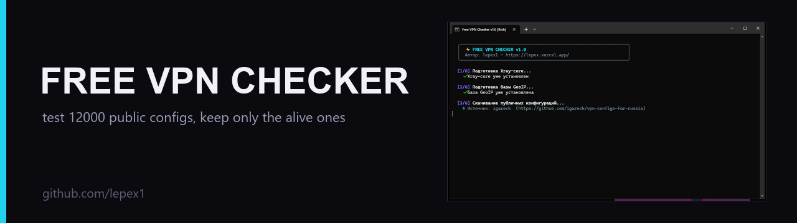
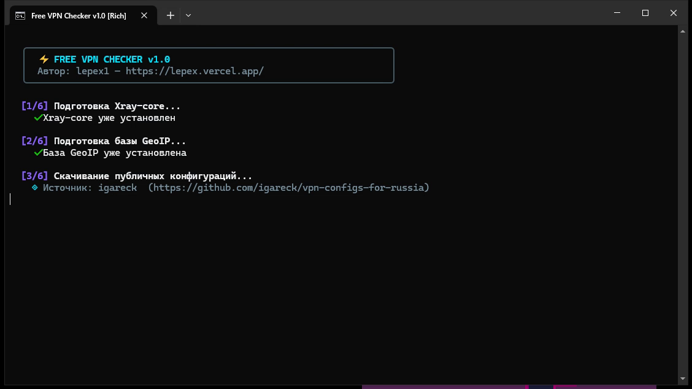
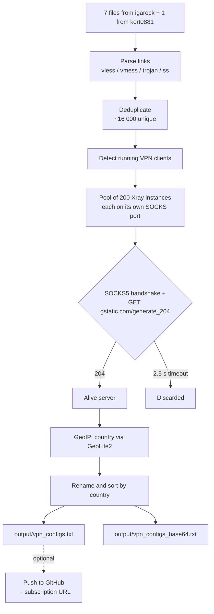

# Free VPN Checker

<p align="center">
  
</p>

<p align="center">
  <a href="https://github.com/lepex1/free-vpn-checker/releases/latest"></a>
  <a href="https://github.com/lepex1/free-vpn-checker/releases"></a>
  
  
  <a href="LICENSE"></a>
</p>

<p align="center">
  <b>Downloads public VPN configs, actually tests every one of them through Xray-core,<br>
  and builds a ready-to-use subscription from the alive ones only.</b>
</p>

<p align="center">
  <a href="README.md">🇷🇺 Русский</a> · <a href="https://lepex.vercel.app/portfolio/free-vpn-checker">Project page</a>
</p>

<!--
  DEMO SLOT: record assets/demo.gif (terminal, ~960 px wide, up to 5 MB) and uncomment the block below.
<p align="center">
  
</p>
-->

---

## Why it exists

Public VLESS/VMess/Trojan/Shadowsocks lists are refreshed daily, yet 80–95 % of the links are dead: the server is off, the port is closed, the config is malformed. Checking them by hand in a client is not feasible.

`free-vpn-checker` does it for you:

1. **Downloads** ~16 000 public configs from [igareck](https://github.com/igareck/vpn-configs-for-russia) and [kort0881](https://github.com/kort0881/vpn-vless-configs-russia).
2. **Tests each one for real**: spins up a dedicated Xray-core, performs a SOCKS5 handshake and an HTTP request to `gstatic.com/generate_204`. That is not a port ping — traffic goes through the proxy exactly like a real client would.
3. **Resolves the country** with the GeoLite2 database (MaxMind) and renames servers into something human: `1. 🇫🇮 Finland`, `2. 🇩🇪 Germany`…
4. **Sorts** by location popularity and writes two ready files: a plain list and a base64 subscription.
5. *(Optional)* **Publishes the subscription to your GitHub** and gives you a single URL to paste into a client.

In test runs roughly **10–12 thousand servers stay alive out of ~16 thousand** unique links; the rest is filtered out.

---

## Screenshot

<p align="center">
  
</p>

---

## Compatibility

| Item | Value |
|---|---|
| **OS** | Windows 10/11 — tested (both the prebuilt `.exe` and running from source). Linux and macOS — the code supports both, but has not been tested |
| **Clients** | Happ, v2rayN, NekoBox, V2RayTun, Throne — all understand the subscription format |
| **Protocols** | VLESS (including Reality), VMess, Trojan, Shadowsocks. `hysteria2`/`tuic` are skipped: Xray-core cannot test them |
| **Engine** | Xray-core 1.8.24 — downloaded automatically when missing |

---

## Quick start (Windows)

1. Download **`free-vpn-checker.exe`** from the **[Releases](https://github.com/lepex1/free-vpn-checker/releases/latest)** page.
2. Run it. Windows may show a SmartScreen warning — normal for unsigned PyInstaller builds: "More info" → "Run anyway".
3. Wait for the check to finish (usually a few minutes; depends on how many configs there are and whether VPN clients are running).
4. When asked about a GitHub token:
   - **paste a Personal Access Token** — the tool creates a repository with your subscription and prints a ready URL;
   - **or just press Enter** — everything stays local in the `output/` folder.

**Output:** `output/vpn_configs.txt` (plain list) and `output/vpn_configs_base64.txt` (base64 subscription), next to the executable.

---

## Run from source

```bash
git clone https://github.com/lepex1/free-vpn-checker.git
cd free-vpn-checker
pip install -r requirements.txt
python main.py
```

**Requirements:** Python 3.10+, Windows (no compilation needed — dependencies are pure Python).

### Build a standalone .exe

```bash
pip install pyinstaller
python build.py
```

Result: `dist/free-vpn-checker.exe` (≈10 MB, Python bundled inside).

---

## How the check works



What makes this different from "ping checkers":

- **Isolated routing per server**: every Xray instance listens on its own SOCKS port (starting at 21400), so tests never interfere with each other.
- **Content check**: only an HTTP 204 from `gstatic.com` counts as success — not merely an open TCP port.
- **Binary search for broken configs**: if a config crashes Xray, the batch is split in half to isolate the culprit without losing the rest of the batch.
- **VPN client warning**: if Happ/Xray/other clients are running, the tool warns that they hold ports and may skew results.

---

## GitHub subscription: what exactly is needed

- Create a classic token at [github.com/settings/tokens](https://github.com/settings/tokens).
- **The only scope required is `repo`** (create and update a file in a repository).
- The token and repository name are stored **in plaintext** in `data/github_config.json` next to the executable. Keep that in mind on shared machines.
- You can revoke access at any time on the same tokens page.

If you do not need publishing, just press Enter and everything stays local.

---

## ⚠️ Read this

- The configs are **someone else's servers**. Their owners can see all of your traffic.
- This is **not a replacement for a proper VPN**: a server can disappear within an hour, log your requests or tamper with traffic.
- Do not use these configs for banking, government services, or anything requiring real privacy.
- The tool does not send your data anywhere except the GitHub repository you configure.

---

## FAQ

**SmartScreen / antivirus flags the `.exe`.**
Common for unsigned PyInstaller builds (a code-signing certificate costs money). You can run it from source instead — the code is open.

**"No alive servers found".**
Usually means a VPN client is running and holding ports, or your ISP blocks everything. Close the clients and retry.

**The check takes very long.**
Speed depends on the number of configs and server responsiveness. With VPN clients running, many tests hit the timeout.

**Can I test my own configs?**
Yes: put them into a file and add the source to `SOURCES` in `config.py`.

**The subscription updated, but the client shows the old list.**
Clients cache subscriptions — refresh manually (v2rayN: "Update subscription via proxy", Happ: pull to refresh).

---

## License

[MIT](LICENSE) — use it, fork it, change it.

This project is **not affiliated** with the authors of public config lists and hosts no servers. Third-party components and their licenses are listed in [THIRD-PARTY-NOTICES.md](THIRD-PARTY-NOTICES.md): Xray-core (MPL-2.0), MaxMind GeoLite2 databases, config sources (GPL-3.0).

---

<p align="center">
  Built by <a href="https://lepex.vercel.app/">lepex1</a>
</p>
