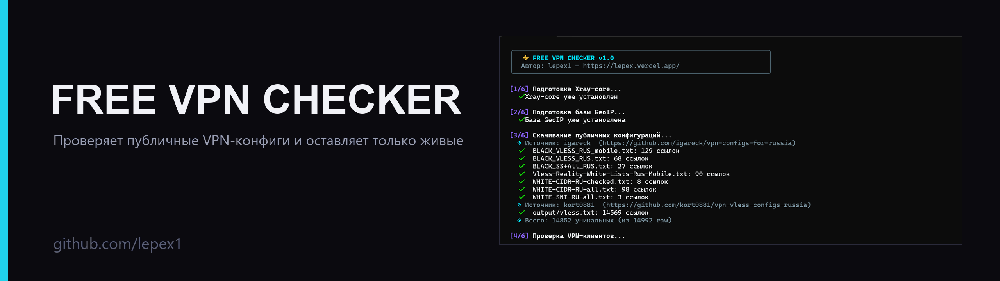
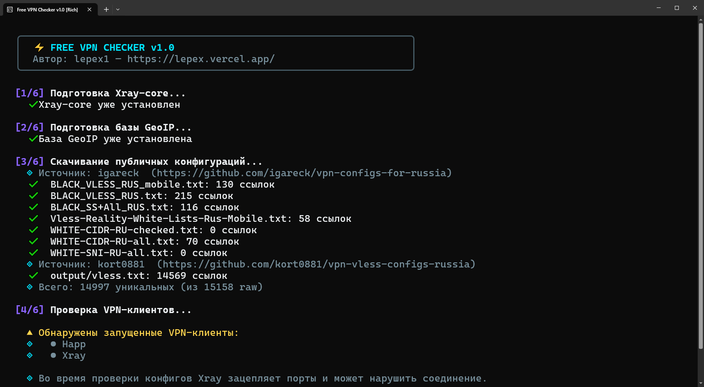
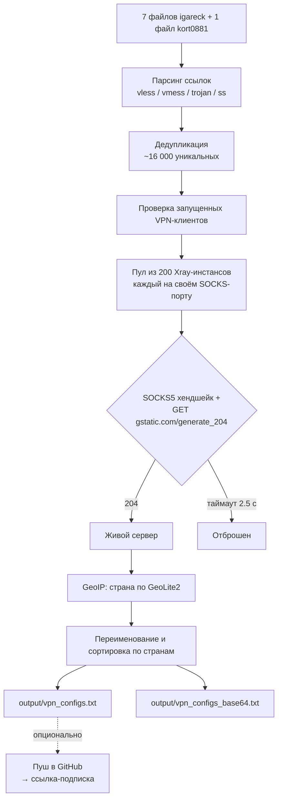

<p align="center">
  <b>Русский</b> · <a href="README.en.md">English</a>
</p>

# Free VPN Checker

<p align="center">
  
</p>

<p align="center">
  <a href="https://github.com/lepex1/free-vpn-checker/releases/latest"></a>
  <a href="https://github.com/lepex1/free-vpn-checker/releases"></a>
  
  
  <a href="LICENSE"></a>
</p>

<p align="center">
  <b>Скачивает публичные VPN-конфиги, реально проверяет каждый через Xray-core<br>
  и собирает готовую подписку только из живых серверов.</b>
</p>

<p align="center">
  <a href="https://lepex.vercel.app/portfolio/free-vpn-checker">Страница проекта</a>
</p>

<!--
  ДЕМО-СЛОТ: записать assets/demo.gif (терминал, ширина ~960 px, до 5 МБ) и раскомментировать блок ниже.
<p align="center">
  
</p>
-->

---

## Зачем это нужно

Публичные списки VLESS/VMess/Trojan/Shadowsocks обновляются каждый день, но 80–95 % ссылок в них мертвы: сервер выключен, порт закрыт, конфиг битый. Проверять их руками через клиент невозможно.

`free-vpn-checker` делает это сам:

1. **Скачивает** ~16 000 публичных конфигов из репозиториев [igareck](https://github.com/igareck/vpn-configs-for-russia) и [kort0881](https://github.com/kort0881/vpn-vless-configs-russia).
2. **Тестирует каждый по-настоящему**: поднимает отдельный Xray-core, делает SOCKS5-хендшейк и контрольный HTTP-запрос на `gstatic.com/generate_204`. Это не «пинг порта» — проверка идёт сквозь прокси, как у реального клиента.
3. **Определяет страну** по базе GeoLite2 (MaxMind) и переименовывает серверы в читаемый вид: `1. 🇫🇮 Финляндия`, `2. 🇩🇪 Германия`…
4. **Сортирует** по популярности локаций и выдаёт два готовых файла: обычный список и base64-подписку.
5. *(Опционально)* **Публикует подписку в ваш GitHub** и отдаёт одну ссылку, которую можно вставить в клиент.

В тестовых прогонах живыми остаются порядка **10–12 тыс. серверов из ~16 тыс.** уникальных ссылок — остальное отсеивается.

---

## Скриншот

<p align="center">
  
</p>

---

## Совместимость

| Параметр | Значение |
|---|---|
| **ОС** | Windows 10/11 — протестировано (готовый `.exe` и запуск из исходников). Linux и macOS — код содержит поддержку обеих платформ, но тесты не проводились |
| **Клиенты** | Happ, v2rayN, NekoBox, V2RayTun, Throne — все понимают формат подписки |
| **Протоколы** | VLESS (включая Reality), VMess, Trojan, Shadowsocks. `hysteria2`/`tuic` пропускаются: ядро Xray их не тестирует |
| **Движок** | Xray-core 1.8.24 — скачивается автоматически, если его нет рядом |

---

## Быстрый старт (Windows)

1. Скачай **`free-vpn-checker.exe`** со страницы **[Releases](https://github.com/lepex1/free-vpn-checker/releases/latest)**.
2. Запусти файл. Windows может показать SmartScreen — это обычное поведение для неподписанных сборок PyInstaller, жми «Подробнее» → «Выполнить в любом случае».
3. Дождись окончания проверки (обычно несколько минут; зависит от количества конфигов и запущенных VPN-клиентов).
4. На вопрос про GitHub-токен:
   - **вставь Personal Access Token** — программа создаст приватный/публичный репозиторий с подпиской и выдаст готовую ссылку;
   - **или просто нажми Enter** — тогда всё останется локально в папке `output/`.

**Где результат:** `output/vpn_configs.txt` (обычный список) и `output/vpn_configs_base64.txt` (base64-подписка) рядом с `.exe`.

---

## Запуск из исходного кода

```bash
git clone https://github.com/lepex1/free-vpn-checker.git
cd free-vpn-checker
pip install -r requirements.txt
python main.py
```

**Требования:** Python 3.10+, Windows (для `pip install` ничего компилировать не нужно — зависимости чистые).

### Сборка автономного .exe

```bash
pip install pyinstaller
python build.py
```

Результат — `dist/free-vpn-checker.exe` (≈10 МБ, Python внутрь уже вшит).

---

## Как работает проверка



Что отличает проверку от «чековых пинговалок»:

- **Изолированная маршрутизация** на каждый сервер: у каждого Xray свой входящий SOCKS-порт (начиная с 21400), поэтому тесты не мешают друг другу.
- **Проверка содержимого**: успехом считается только HTTP 204 от `gstatic.com`, а не просто открытый TCP-порт.
- **Бинарный поиск битого конфига**: если конфиг роняет Xray, алгоритм делит пачку пополам и локализует виновника, не теряя остальные серверы из пачки.
- **Предупреждение про VPN-клиенты**: если запущены Happ/Xray/другие клиенты, программа предупредит, что они занимают порты и могут исказить результат.

---

## GitHub-подписка: что именно нужно

- Токен создаётся на [github.com/settings/tokens](https://github.com/settings/tokens) (classic).
- **Единственный нужный scope — `repo`** (создание и обновление файла в репозитории).
- Токен и имя репозитория сохраняются в **`data/github_config.json` в открытом виде** — это обычный файл рядом с программой. Если это важно, не запускай её на чужой машине.
- Отозвать доступ можно в любой момент на той же странице токенов.

Если токен не нужен — просто нажми Enter, всё останется локально.

---

## ⚠️ Важно понимать

- Конфиги **чужие**. Их владельцы видят весь ваш трафик на своём сервере.
- Это **не замена нормальному VPN**: сервер может исчезнуть через час, логировать запросы или подменять трафик.
- Не используй полученные конфиги для банковских операций, госуслуг и любых сервисов, где важна приватность.
- Программа не хранит и не передаёт ваши данные никуда, кроме GitHub-репозитория, который ты сам указал.

---

## Частые вопросы

**SmartScreen/антивирус ругается на `.exe`.**
Так бывает со всеми неподписанными сборками PyInstaller (сертификат подписи стоит денег). Можно не доверять бинарнику и запустить из исходников — код открыт.

**«Рабочих серверов не найдено».**
Обычно значит, что запущен VPN-клиент и занимает порты, либо провайдер блокирует всё подряд. Закрой клиенты и попробуй ещё раз.

**Проверка идёт очень долго.**
Скорость зависит от числа конфигов и от того, насколько быстро отвечают серверы. При запущенных VPN-клиентах часть тестов уходит в таймаут.

**Можно ли проверить свои конфиги?**
Да: положи их в файл и добавь источник в `SOURCES` в `config.py`.

**Подписка обновилась, а клиент показывает старый список.**
Клиент кеширует подписку — обнови её вручную (в v2rayN: «Обновить подписку через прокси», в Happ: потянуть вниз).

---

## Лицензия

[MIT](LICENSE) — используй, форкай, меняй.

Проект **не связан** с авторами публичных списков конфигов и не размещает серверы. Список сторонних компонентов и их лицензий — в [THIRD-PARTY-NOTICES.md](THIRD-PARTY-NOTICES.md): Xray-core (MPL-2.0), базы MaxMind GeoLite2, источники конфигов (GPL-3.0).

---

<p align="center">
  Сделал <a href="https://lepex.vercel.app/">lepex1</a>
</p>
